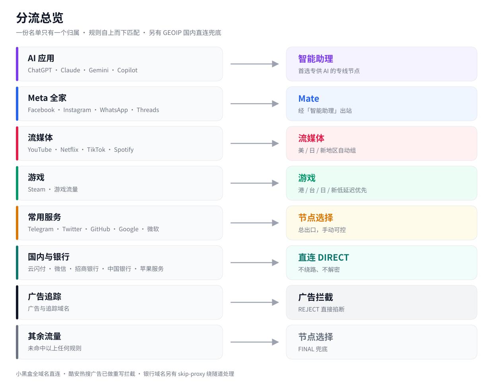
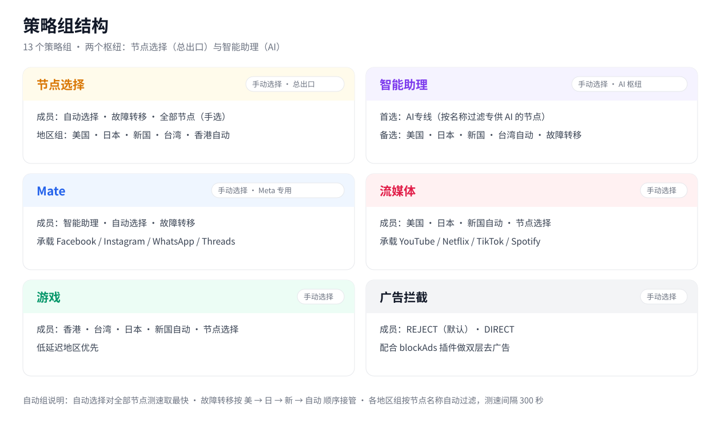

# 鱼甜的 Loon 配置

  

一份极简、重分流的 Loon 配置：AI 与 Meta 各走专线枢纽，国内与银行全直连，广告双层拦截。配置文件不含任何订阅与个人信息。

## 分流总览



## 策略组结构



## 快速上手

**第一步 · 导入配置**

复制下方地址，在 Loon 中打开「设置 → 配置 → 下载配置」，粘贴后导入：

```
https://raw.githubusercontent.com/Theyutian/Yutian_Loon/main/yutian.lcf
```

**第二步 · 添加订阅**

在 Loon「节点」页点右上角 **+**，粘贴你自己的订阅链接并保存。订阅保存在 Loon 的订阅库中，此后更新配置不会丢节点。

**第三步 · 选一次 AI 节点**

打开「智能助理」组：若订阅里有专供 AI 的节点（名称含 `AI JUST FOR AGENT`），点选它一次；没有也没关系，组内的地区自动组会兜底。

**第四步 · 开启去广告**

配置已内置 blockAds 插件。首次使用需在 Loon「设置 → MitM」中生成 CA 证书，安装后到系统「设置 → 通用 → 关于本机 → 证书信任设置」里信任它，去广告才完整生效。

## 使用说明

- **银行与支付**：招商银行、中国银行、云闪付、微信均已直连，银行域名另有 skip-proxy 绕隧道处理，开启 Loon 不影响使用。若中国银行 App 打不开，在 Loon「配置 → MitM → 主机名」中添加 `-openapi.boc.cn` 与 `-mlife.jf365.boc.cn` 两条排除即可。
- **更新配置**：在 Loon 中对该配置执行「更新」即可，订阅与本地设置不受影响。
- **规则来源**：[blackmatrix7/ios_rule_script](https://github.com/blackmatrix7/ios_rule_script)、[fmz200 blockAds](https://github.com/fmz200/wool_scripts)、[viewer12 OverseasAI](https://github.com/viewer12/OverseasAI.list)、[KnowSky404 微信名单](https://github.com/KnowSky404/ProxyKit)，感谢原作者。
